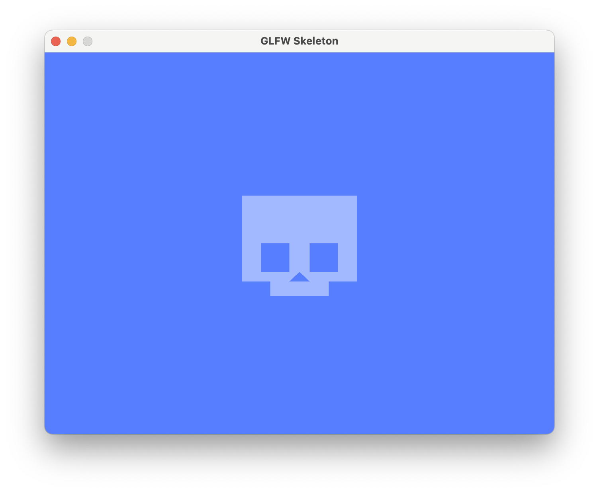
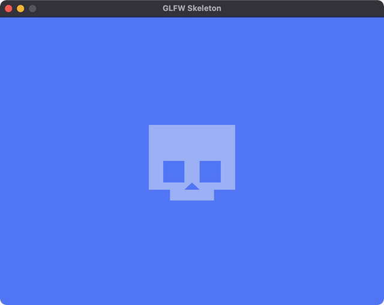
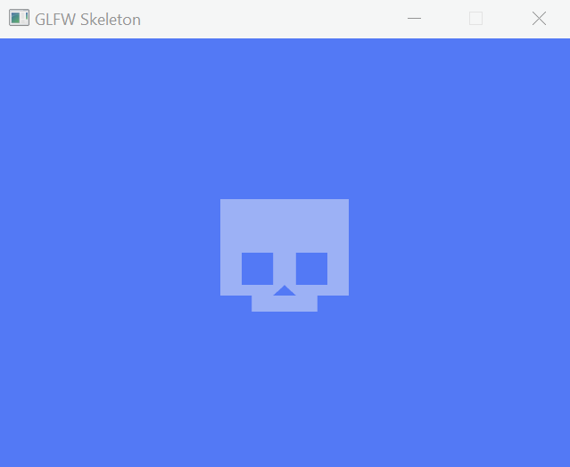
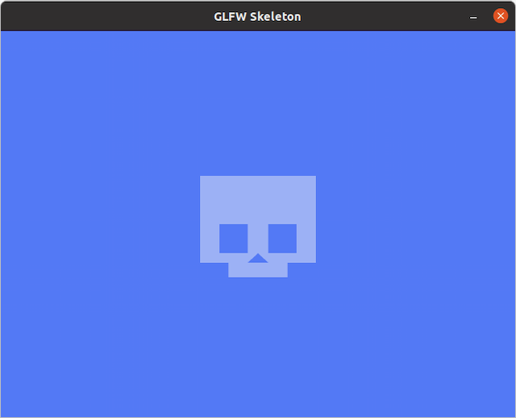

# glfw-skeleton [](https://github.com/andystanton/glfw-skeleton/actions/workflows/build.yml)

A skeleton C++20 OpenGL 4.1 app that uses [glfw](http://www.glfw.org), [glad](https://glad.dav1d.de), and [glm](http://glm.g-truc.net) libraries and builds with [CMake](http://www.cmake.org/) to enable rapid cross-platform hacking with OpenGL.

glfw and glm are retrieved and built using CMake's FetchContent. glad uses pre-generated OpenGL loader files committed to the repository.



## Requirements

- C++20
- OpenGL 4.1
- CMake 3.21+
- Make (macOS/Linux, optional)
- Modern C++ compiler (GCC 10+, Clang 11+, MSVC 2019+)

To regenerate glad OpenGL loader files (optional):
- Python 3 with jinja2 module (installed automatically in `.venv` by `make regenerate-glad`)

## Quick Start

### Using Make (macOS/Linux)

```sh
git clone https://github.com/andystanton/glfw-skeleton.git
cd glfw-skeleton
make run              # Build and run (debug by default)
make release          # Build release version
make help             # Show all available targets
```

### Using CMake directly (all platforms)

```sh
git clone https://github.com/andystanton/glfw-skeleton.git
cd glfw-skeleton

# Configure and build (debug)
cmake --preset=debug
cmake --build build/debug

# Run
./build/debug/bin/glfw-skeleton

# Or for release build
cmake --preset=release
cmake --build build/release
./build/release/bin/glfw-skeleton
```

### Windows (Visual Studio)

- Clone the repository
- Open the folder in Visual Studio 2019+ (CMake support required)
- Visual Studio will automatically detect CMakePresets.json
- Select your desired preset (debug/release) from the configuration dropdown
- Build and run using F5

## Compatibility

Tested on macOS 11.6, Windows 10, & Ubuntu 20.04.

| macOS   | Windows | Linux |
| ------- | ------- | ----- |
|  |  |  |

